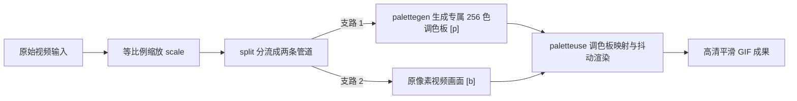

> **摘要**：在日常开发与生活中，我们经常需要将手机录制的 MP4 短视频转为 GIF 动图，或分享到微信作为动态表情包。但新手往往会遇到三大痛点：**画面莫名倾斜旋转**、**画质充满噪点与色彩断层**、**发到微信变成文件无法直接播放**。本文将带你从原理到实战，彻底解决这些问题。

---

## 目录

1. [痛点分析：为什么直接转码效果极差？](#一-痛点分析为什么直接转码效果极差)
2. [核心技术：FFmpeg 高画质调色板算法](#二-核心技术ffmpeg-高画质调色板算法)
3. [解决方向问题：手机视频的旋转元数据怪相](#三-解决方向问题手机视频的旋转元数据怪相)
4. [微信平台规则与极致压缩调优](#四-微信平台规则与极致压缩调优)
5. [实战方案：三大常用命令模板](#五-实战方案三大常用命令模板)
6. [在微信中正确发送（避免变成文件）](#六-在微信中正确发送避免变成文件)
7. [总结与一键脚本](#七-总结与一键脚本)

---

## 一、 痛点分析：为什么直接转码效果极差？

很多人的第一反应是用最直观的命令：

```bash
ffmpeg -i input.mp4 output.gif
```

运行后通常会面临三个尴尬问题：

1. **体积巨大**：几十秒甚至几秒的视频，导出的 GIF 可能高达几十 MB。
2. **画质稀烂**：画面布满色斑、暗部全是噪点，人脸肤色出现一圈圈断层。
3. **微信拒收**：发到微信直接变成了一个带有 `.gif` 后缀的“灰色文件卡片”，必须手动下载，无法自动循环播放。

---

## 二、 核心技术：FFmpeg 高画质调色板算法

### 1. 为什么会有色彩断层？

MP4 视频使用的是 24-bit 真彩色（数千万种颜色），而 **GIF 规范（GIF89a）天生限制：单帧最多只能容纳 256 种颜色（8-bit）**。
直接转码时，FFmpeg 只能套用通用的静态调色板去强行匹配，结果可想而知。

### 2. 两阶段优化法：`palettegen` + `paletteuse`

现代 FFmpeg 提供了专业的高清方案：

1. **阶段一（分析）`palettegen`**：先完整扫描一遍原视频，根据视频中出现的所有颜色，**量身定制**一张专属于该视频的 256 色全局调色板。
2. **阶段二（渲染）`paletteuse`**：利用生成的专属调色板，配合高质量抖动算法（Dithering），在仅有 256 色限制下呈现极度平滑的过渡色彩。



---

## 三、 解决方向问题：手机视频的旋转元数据怪相

### 1. 诡异的“斜拍”现象

手机拍摄时（尤其是竖屏拍摄或横竖切换瞬间），相机会在视频容器中打入旋转元数据标签，例如：

```text
Side data:
  displaymatrix: rotation of 90.00 degrees
```

* **播放器逻辑**：播放器读取到 90° 标签，会自动顺时针旋转 90°，导致原本正向的内容被强制放倒。
* **FFmpeg 默认逻辑**：FFmpeg 默认具有 `autorotate` 特性，会自动执行逆矩阵旋转。如果原始像素本身已经是竖立的，这一层“自动修正”反而会导致画面歪斜！

### 2. 解决方案：`-noautorotate`

只需要在 `-i` 输入参数**之前**加上 `-noautorotate`：

```bash
ffmpeg -noautorotate -i input.mp4 ...
```

它能命令 FFmpeg **忽略元数据旋转指令，直接读取底层原始像素**，省去反向转动的多余损耗，一步回归正位。

---

## 四、 微信平台规则与极致压缩调优

为了让 GIF 能像表情包一样在微信直接动态播放，必须严守微信的机制：

| 机制类型                           | 体积阈值                             | 表现                                     | 适用方案                             |
| :--------------------------------- | :----------------------------------- | :--------------------------------------- | :----------------------------------- |
| **添加到自定义表情（❤️）** | **严格 < 5 MB**（推荐 1~3 MB） | 永久作为表情包使用，点击即发             | 降低分辨率至 240p，帧率调至 10~12fps |
| **聊天中直接发送动图**       | 手机端相册发送：**< 5 MB**     | 聊天气泡内自动播放                       | 电脑端复制粘贴，手机端相册发送       |
| **超过限制（> 5 MB）**       | —                                   | **变成灰色文件卡片**，无法动图播放 | 必须压缩降码率                       |

---

## 五、 实战方案：三大常用命令模板

### 模板 1：原画级高清 GIF（适合博客/文档演示）

保持全分辨率与最高色彩保真度：

```bash
ffmpeg -noautorotate -i input.mp4 -filter_complex \
"[0:v] split [a][b]; \
 [a] palettegen [p]; \
 [b][p] paletteuse" \
high_quality.gif
```

### 模板 2：微信表情包推荐版（平衡画质与体积，约 2~3 MB）

采用 `scale=240:-1` 保持比例缩放，Lanczos 锐利重采样，12 fps 保持流畅：

```bash
ffmpeg -noautorotate -i input.mp4 -filter_complex \
"[0:v] fps=12,scale=240:-1:flags=lanczos,split [a][b]; \
 [a] palettegen=max_colors=192 [p]; \
 [b][p] paletteuse=dither=bayer:bayer_scale=3" \
wechat_sticker.gif
```

### 模板 3：极致轻量版（秒发秒开，约 1 MB）

针对网络较差或超严格场景（10 fps，128 色阶）：

```bash
ffmpeg -noautorotate -i input.mp4 -filter_complex \
"[0:v] fps=10,scale=180:-1:flags=lanczos,split [a][b]; \
 [a] palettegen=max_colors=128 [p]; \
 [b][p] paletteuse=dither=bayer:bayer_scale=3" \
wechat_sticker_light.gif
```

#### 参数参数精要速查：

* `fps=10`：降低帧率，肉眼无明显顿挫，但体积直接直降 20%~30%。
* `scale=240:-1`：固定宽为 240 像素，高按比例自适应（`-1`）。
* `flags=lanczos`：高级图像降采样算法，保留文字和边缘锐度。
* `max_colors=192`：限制调色板最大颜色数，进一步削减体积。
* `dither=bayer:bayer_scale=3`：采用 Bayer 抖动算法，大幅减少传统 Floyd-Steinberg 产生的麻点，更省体积。

---

## 六、 在微信中正确发送（避免变成文件）

生成符合尺寸的 GIF 后，**发送姿势决定了它是“文件”还是“动图”**：

### 1. 手机端（最推荐：添加为常用表情包）

1. 将 GIF 发送到手机并**保存到系统相册**；
2. 打开任意聊天窗口，点击输入框右侧的 **表情（笑脸）图标**；
3. 切换到底部工具栏的 **爱心（❤️）**（添加的单个表情列表）；
4. 点击最左上方的 **“+” 号**，从相册选中该 GIF 即可添加成功；
5. 以后点击即发，完全就是原生表情包！

### 2. 电脑端微信直接发送动图

* ❌ **错误做法**：直接把 `.gif` 文件从文件夹拖拽进输入框（必定变成文件卡片）。
* ✔️ **正确做法**：双击用浏览器打开该 GIF，在画面上右键点击 **“复制图片”**（注意不是复制文件），然后在微信输入框中按 `Ctrl + V` 粘贴发送即可！

---

## 七、 总结与一键脚本

### 核心结论速记：

1. 画面倾斜不用愁，输入前面加 `-noautorotate`。
2. 色斑噪点不用怕，`palettegen` + `paletteuse` 调色板双通道显神威。
3. 微信表情大小必须控制在 **5MB 以内**（最佳 1~3MB）。

### 自动化脚本（Windows PowerShell 版）

如果你经常需要处理此类需求，可以保存为 `mp4_to_sticker.ps1`：

```powershell
param(
    [Parameter(Mandatory=$true)][string]$InputFile,
    [string]$OutputFile = "sticker.gif",
    [int]$Width = 240,
    [int]$Fps = 12
)

ffmpeg -y -noautorotate -i $InputFile -filter_complex `
"[0:v] fps=$Fps,scale=$Width`:-1:flags=lanczos,split [a][b]; `
 [a] palettegen=max_colors=192 [p]; `
 [b][p] paletteuse=dither=bayer:bayer_scale=3" `
$OutputFile

Write-Host "转换完成: $OutputFile" -ForegroundColor Green
```
