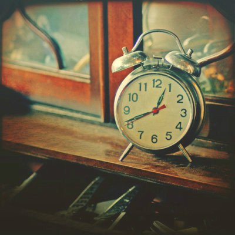

---
# the default layout is 'page'
icon: fas fa-info-circle
order: 4
---

{: .w-50 .rounded-10 }

每天晚上疲惫地坐到椅子上时，才觉得真真切切地过了一天。人生最重要的并不是努力，而是方向。压力不是有人比你努力，而是那些比你牛x几倍的人依然比你努力。

即使看不到未来，即使看不到希望，也依然相信，自己选的认识错不了。第二天叫醒我的不是闹钟，其实，还是梦想。
